

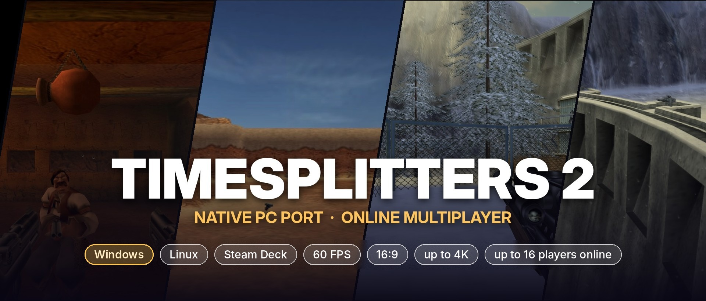

# TimeSplitters 2 — Native PC Port

**The PS2 classic, recompiled into a real PC game — no emulator. Windows, Linux and Steam Deck. 
60 FPS, true 16:9, up to 4K, mouse and keyboard, split-screen, and the online multiplayer the PS2 version never got.**

[News](news/README.md) · [Play it](#play-it-in-3-minutes) · [Online](#online-multiplayer) · [What makes it different](#what-makes-it-different) · [Gallery](#gallery) · [Before / after](#before--after) · [FAQ](#faq) · [Status](#status) · [How it works](#how-it-works) · [Docs](#documentation)

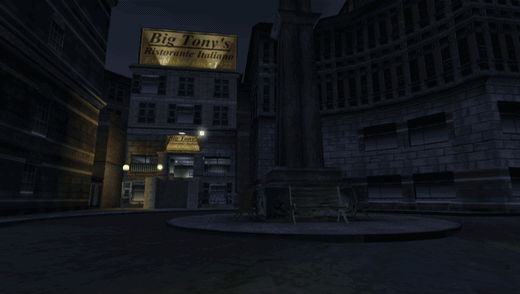
Level intros (Chicago, Aztec, the Siberia opening) straight from the port: 16:9, 2× internal resolution, no ghosting. Captured from an automated run, every 4th frame.

<!-- news:start -->
## 📣 News

<table>
<tr>
<td width="50%" valign="top"><a href="news/2026-11-14-bug-fixes-and-updates.md">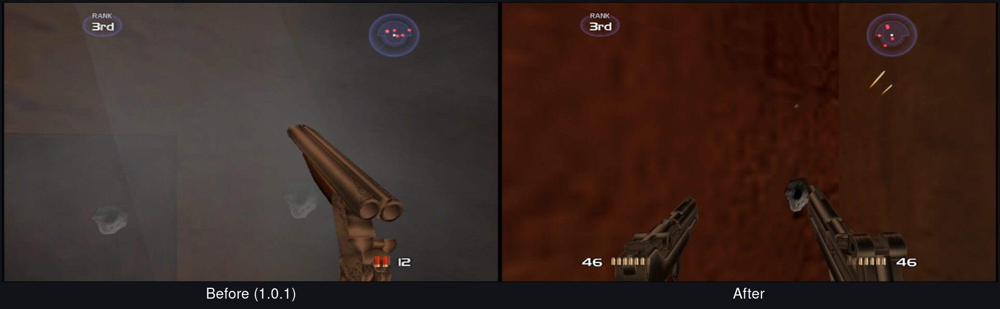</a> 2026-11-14 · Update <b><a href="news/2026-11-14-bug-fixes-and-updates.md">Bug fixes and updates - 1.1 is on the way</a></b> Thanks for the reports! The German launcher on Windows, the black bars, the grey smoke wall and a lobby freeze are fixed. The update goes up as soon as the last round of testing is through.</td>
<td width="50%" valign="top"><a href="news/2026-11-13-whats-new-1-1.md">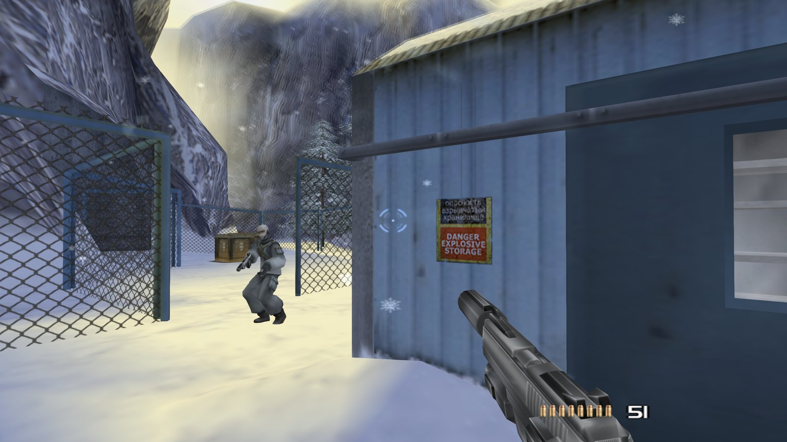</a> 2026-11-13 · Dev log <b><a href="news/2026-11-13-whats-new-1-1.md">What's new in 1.1, and what's still in testing</a></b> A new launcher with automatic updates, proper 16:9 menus and HUD, mouse aiming, a clearer sniper scope and online play. Here's what's done and what's still being tested.</td>
</tr>
</table>

All posts, patch notes and what's coming next: <a href="news/README.md">news</a>
<!-- news:end -->

> [!TIP]
> **🪟 1.0.1: TimeSplitters 2 now runs natively on Windows 10 / 11.** Same idea as on Linux: download, extract,
> pick your disc image – nothing to install. Direct3D 11, 60 FPS, the first story level played through on a real PC
> without a single error. It took three fixes nobody could see under Wine ([the story](docs/WINDOWS_PORT.md)).
> Also new: the **HUD sits at the 16:9 edges** and the **sniper scope** finally fits widescreen.
>
> Still in since 1.0: **online multiplayer** with an in-game server browser ([how it works](docs/ONLINE.md)),
> **mouse and keyboard** ([open points](docs/MOUSE.md)), a settings menu in the game's own style (English / Deutsch),
> **F8 video recording** and an **F7 free camera** for screenshots.

<table>
<tr>
<td align="center" width="16%"><b><big>60 FPS</big></b> every frame shown, 16.7 ms each</td>
<td align="center" width="16%"><b><big>16:9</big></b> real Hor+ widescreen, HUD at the edges</td>
<td align="center" width="16%"><b><big>up to 8×</big></b> internal resolution (4K and above)</td>
<td align="center" width="16%"><b><big>16 players</big></b> online with server browser</td>
<td align="center" width="16%"><b><big>3 platforms</big></b> Windows 10 / 11, Linux, Steam Deck</td>
<td align="center" width="16%"><b><big>~3 min</big></b> from disc image to playing</td>
</tr>
<tr>
<td align="center" colspan="6">Story 10/10 levels · Arcade League · Challenge · MapMaker · co-op split-screen · checked frame by frame against PCSX2</td>
</tr>
</table>

## Play it in 3 minutes

Download the package for your system from [**Releases**](https://github.com/Destinity13/TimeSplitters-2-Native-Linux-Recomp/releases/latest),
extract it, start the launcher and pick **your** disc image. The launcher checks the disc, extracts it and builds the
game once with a progress bar (about 3 minutes on a desktop PC). Then press **Play**.

Nothing to install: each package brings its own compiler and prebuilt libraries, and only the code generated from
your disc is compiled on your PC.

<table>
<tr><th width="33%" id="windows">🪟 Windows 10 / 11</th><th width="33%" id="linux">🐧 Linux</th><th width="33%" id="steam-deck">🎮 Steam Deck</th></tr>
<tr><td valign="top">

1. Download `…-windows-x86_64.zip`, extract it into a **new** folder
2. Run **`TS2-Recomp.bat`**
3. Pick your ISO, wait, **Play**

Nothing to install; uses Direct3D 11 (Vulkan as fallback). Windows may warn about an unsigned app:
"More info" → "Run anyway". [Details](docs/WINDOWS_PORT.md)

</td><td valign="top">

1. Download `…-linux-x86_64.tar.xz`, extract it
2. Run **`./TS2-Recomp.sh`**
3. Pick your ISO, wait, **Play**

Needs only `python3`; runs on any current distribution.

</td><td valign="top">

1. Set it up in Desktop Mode with the Linux package
2. Add **`TS2-SteamDeck.sh`** to Steam
3. Play in **Game Mode**

Deck detected automatically, tuned for a steady 60 FPS. [Step by step](docs/STEAM_DECK.md)

</td></tr>
</table>

**In the game:** ESC / F1 / Guide = settings menu and server browser · F7 = free camera · F8 = record video · F9 = FPS · F10 = turbo · F11 or Alt+Enter = fullscreen · F12 = screenshot

**Mouse and keyboard:** click into the game to capture the mouse (ESC releases it). Mouse look with the game's own
aim-mode crosshair (pinned to the centre, shots land on it), left = fire, right = zoom (hold), middle/Q = secondary
fire, E/Space = use, R = reload, C = crouch, wheel = weapon, WASD = move. Every key and mouse button can be rebound in
the settings menu while playing; sensitivity, zoom sensitivity and invert are there too. On the Steam Deck mouse
aiming is off by default, and on every system touching the gamepad hands control straight back to it. Mouse play is new
and not finished yet (aim-mode walking speed, vehicles): [what is done and what is open](docs/MOUSE.md).

## Online multiplayer

> [!NOTE]
> New in 1.0. Tested on a LAN so far; the first matches over the internet are what the community list is for – add
> your server with a pull request to [server/servers.txt](server/servers.txt).

The PS2 game had LAN play through the Network Adapter; online play was cut before release. **This port brings it
online.** Everyone on the same **`ts2-server`** meets in *Arcade → Network* as if on one LAN, with all modes, all maps
and up to 16 players.

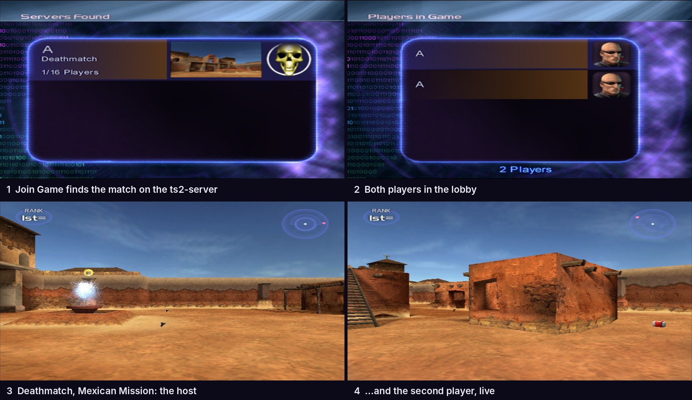

- **In-game server browser** in the style of the classic PC shooters: server list, players, ping, password, favourites, direct address. It opens by itself at *Arcade → Network*.
- **Host your own server** with one command: `./ts2-server --name "My server"`. It is included in the package and is a single C++ file without dependencies (it also builds on Windows with MSVC). [How to host](server/README.md)
- **One server for every platform:** Linux and Steam Deck players meet on the same `ts2-server`; Windows players join the same servers.
- Nothing in the game is changed: you use the original menus, *Start Game* to host and *Join Game* to join.
- **Your IP stays private:** players only ever talk to the server, never to each other. The server is a dumb relay
  with rate limits and connection caps, and ships with a hardened systemd unit. [Security model](server/README.md#security-model)

Roadmap and technical details: [ONLINE](docs/ONLINE.md)

## What makes it different

|  |  |
|---|---|
| **Native, not emulated** | The game's MIPS code is recompiled into C++ and compiled for your CPU. No CPU emulation at runtime; only graphics and sound come from PCSX2's GS and SPU2. |
| **Online the PS2 never had** | The original LAN mode, carried over the internet by a small relay server, with a real server browser. |
| **One click** | Same game on Windows, Linux and Steam Deck. The launcher does everything; you only bring the disc. |
| **Better than the original, faithful where it counts** | 60 FPS, real 16:9 instead of stretching, 1×–8× resolution, optional fixes (frame blending off, no letterbox). Everything else behaves like the PS2. |
| **Checked against PCSX2** | Every fix is measured against the emulator (savestates, screenshots, register logs) before it lands. [VERIFICATION](docs/VERIFICATION.md) |
| **Open and legal** | GPL-3.0, no game data in the repository, every bug and fix documented. [FINDINGS](docs/FINDINGS.md) |

## Features

<table>
<tr><td valign="top" width="50%">

**Picture**
- Real 16:9 (Hor+), HUD at the screen edges, menus kept in 4:3 proportion
- Internal resolution 1×–8×, anisotropic filtering, FXAA, AMD CAS
- Original frame blending ("ghosting" when turning) switchable, **off by default**
- Cutscenes without letterbox bars (switchable)
- PCSX2 texture packs from `texturpakete/`

</td><td valign="top" width="50%">

**Play**
- Locked 60 FPS in game, menus and split-screen
- Split-screen for 2 players; a third gamepad turns on the multitap
- Online play with server browser, up to 16 players
- Modern gamepads (SDL3), rumble, pressure buttons
- Mouse look with the original aim-mode crosshair, free key/mouse binding in the menu *(new, [not finished](docs/MOUSE.md))*
- In-game settings menu, memory card saves, built-in hang report

</td></tr>
</table>

## Gallery

<table>
<tr>
<td width="50%">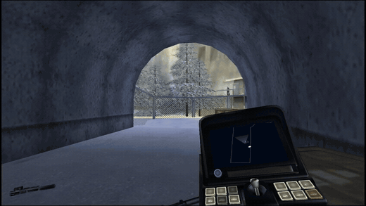</td>
<td width="50%">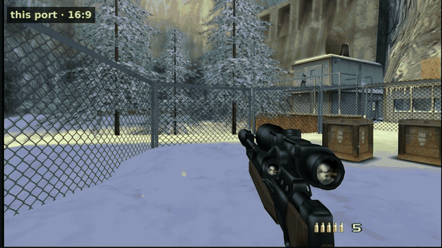</td>
</tr>
<tr>
<td>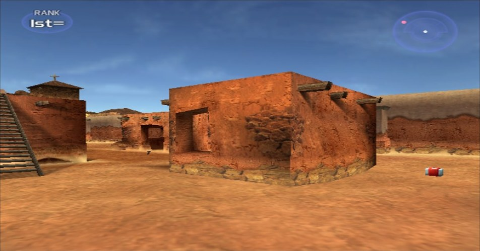</td>
<td>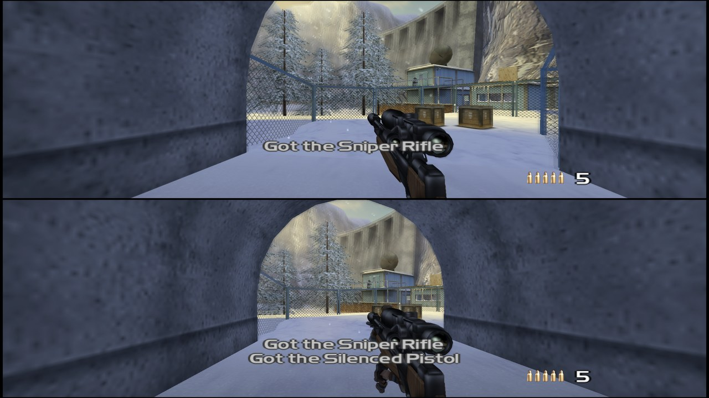</td>
</tr>
<tr>
<td>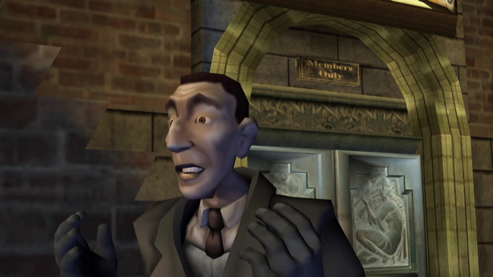</td>
<td>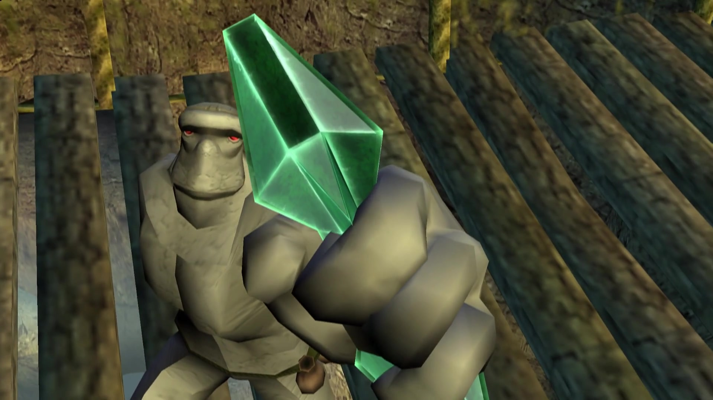</td>
</tr>
<tr>
<td>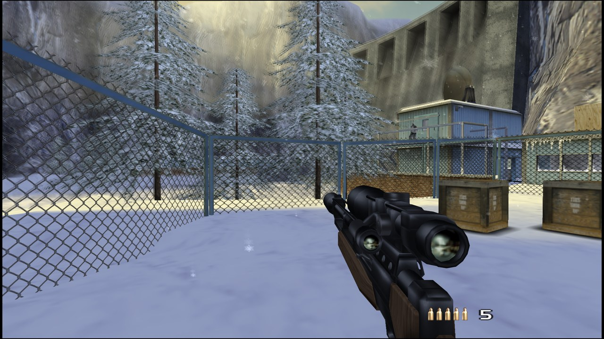</td>
<td>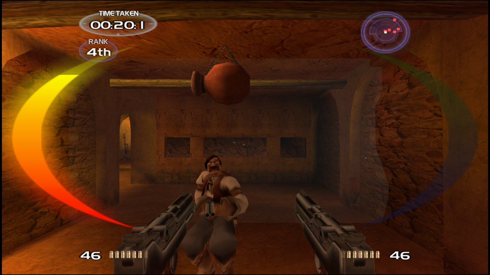</td>
</tr>
<tr>
<td>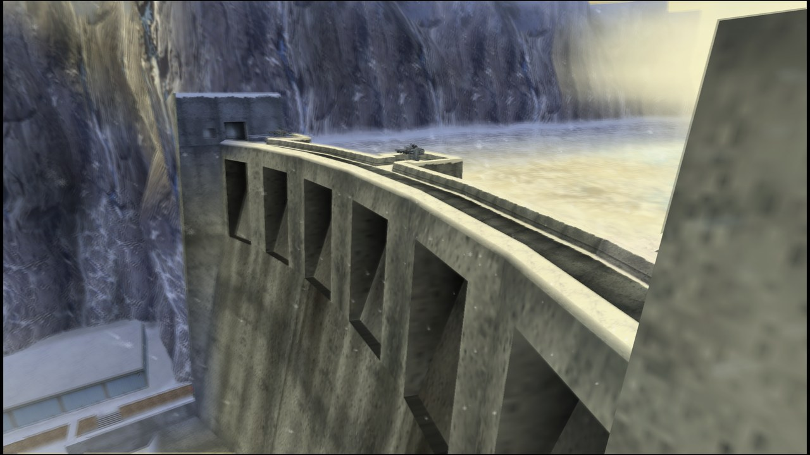</td>
<td>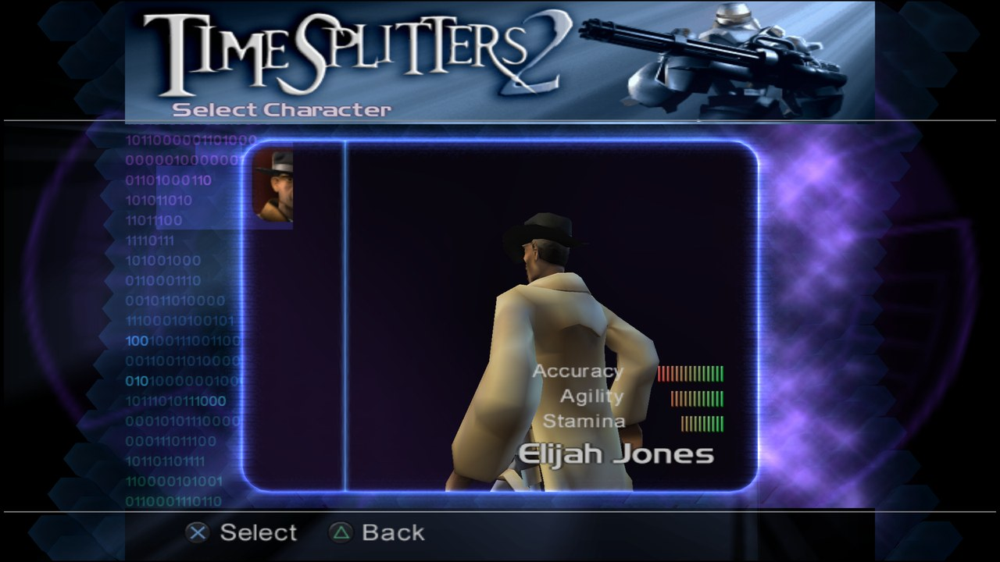</td>
</tr>
</table>
All pictures straight from the port on the author's own disc: no AI upscaling, no texture pack. The two clips were
recorded with the built-in F8 capture.

## Before / after

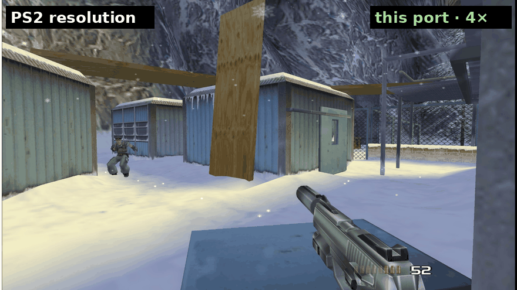

**[▶ Open the interactive slider](https://destinity13.github.io/TimeSplitters-2-Native-Linux-Recomp/compare/)** – drag between
the PS2 picture and the port, for resolution and for 4:3 vs 16:9.

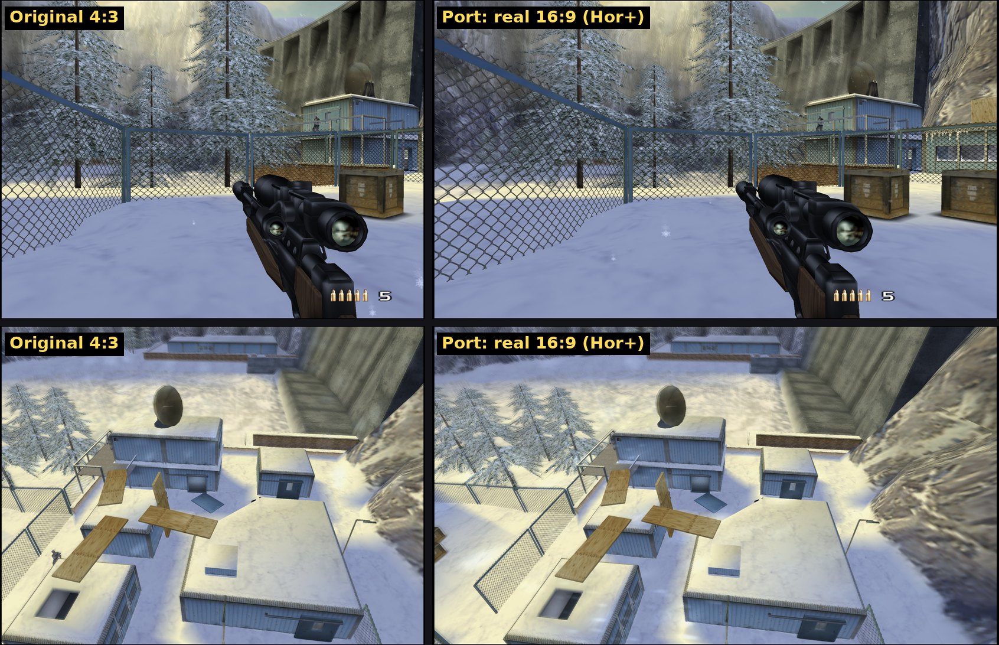

Same frame of the same input replay: original 4:3 (left), real 16:9 with more of the scene (right). All shots from
the port's renderer on the author's own disc, no AI upscaling, no texture pack.

## FAQ

| | |
|---|---|
| **Does it run on Windows?** | Yes, since 1.0.1: Windows 10 and 11, 64-bit, with Direct3D 11 (Vulkan as fallback). The package brings everything it needs, including the compiler that builds your copy. Windows may warn about an unsigned app the first time – "More info" → "Run anyway". |
| **Do I need PCSX2 installed?** | No. The package brings the small GS/SPU2 bridge it needs. Nothing else is installed on your system. |
| **Which disc works?** | The **USA** release, `SLUS-203.14`, as an `.iso` dump of your own disc. PAL and Japanese discs are different builds and will not work (yet). |
| **Is it an emulator with extra steps?** | No. The game's CPU code is translated to C++ once and compiled for your PC. At runtime there is no MIPS interpreter or JIT, only the GS/SPU2 (graphics and sound) from PCSX2. That is why it holds 60 FPS on a Steam Deck. |
| **Why does it compile on my PC?** | Because the translated game code is derived from your disc and must not be distributed. Your PC turns your disc into your build, once, with the compiler that ships in the package. |
| **Controller, mouse or both?** | Both, at the same time. Gamepads through SDL3 (any modern pad, rumble, pressure buttons), mouse look with the game's own crosshair, all keys and buttons rebindable in the menu. Mouse play is the newest part and [not finished](docs/MOUSE.md). |
| **Can I play with friends?** | With 1.0: online through a `ts2-server` (host your own in one command, up to 16 players), or split-screen on one PC today. |
| **Does it change how the game plays?** | No. The PS2 game logic runs unchanged; the visible differences (60 FPS, 16:9, no ghosting, no letterbox) are switchable, and the Easy/Normal/Hard quirks of the original are all still there. |

## Status

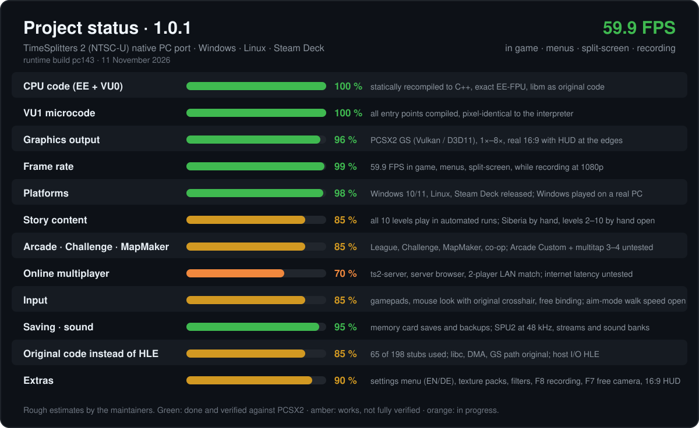

| | |
|---|---|
| ✅ **Already there** | title, profiles, Story (all 10 levels load and play, Siberia played through), Story co-op, Arcade League, Challenge, MapMaker, options, bonus trailer, memory card, sound |
| 🆕 **New in 1.0.1** | **Windows release** · HUD at the 16:9 edges · sniper scope correct in 16:9 · co-op split screen fixed in 16:9 · no PCSX2 messages at start |
| 🆕 **New in 1.0** | online multiplayer with in-game server browser · `ts2-server` in the package · mouse and keyboard play · TS2-style settings menu (EN/DE) · F8 video recording · F7 free camera |
| 🟡 **Being tested** | mouse play beyond Siberia/Arcade ([open points](docs/MOUSE.md)), Story levels 2–10 by hand (automated runs are clean), Arcade Custom, 3–4 players via multitap, online over the internet |
| 🛠 **Coming in updates** | softer snow haze at high resolutions · mouse polish (aim-mode walking speed, vehicles) · dedicated server that runs matches without a hosting player |

Every build: [CHANGELOG](docs/CHANGELOG.md) · open issues: [KNOWN_ISSUES](docs/KNOWN_ISSUES.md) · found a bug?
[Open an issue](https://github.com/Destinity13/TimeSplitters-2-Native-Linux-Recomp/issues) and attach `build/spielen.log` (on Windows also `build\bridge.log`).

**Which TimeSplitters 2 port is this?** As far as we know the only active recompilation of the **PS2** version,
checked frame by frame against PCSX2. [split2-recomp](https://github.com/phobos665/split2-recomp) recompiles the
**Xbox** version instead; both are worth a look.

## How it was built

1. **PCSX2 is the reference, always.** Every scene is first run in PCSX2 with a scripted virtual gamepad; savestates
   at fixed frames give the "truth" for RAM, GS registers and pictures.
2. **The port replays the same inputs headless** and dumps the same things. A difference is a bug; the diff says where.
3. **Fixes go into the recompiler or the runtime, not into the game.** The game's own code stays as it came off the
   disc; every finding is written down ([FINDINGS](docs/FINDINGS.md)), from FPU rounding to a frozen COP0 counter
   that kept the network code silent.
4. **Every build is numbered and tested** (`pc001` … `pc143`): 60 FPS check, all ten story levels, split-screen,
   package setup as a fresh user on Linux, the whole Windows chain under Wine, CI jobs on real Windows and play-tests on a real Windows PC.
5. **Tools were built along the way:** input record/replay, RAM-diff search (that is how the camera and player
   position for mouse look were found), write watches with native backtraces, a hang reporter, frame capture.

A human maintainer sets direction and play-tests on real hardware; an AI coding agent (Claude) does most of the
reverse engineering, implementation and measurement. See [AI disclosure](#ai-disclosure) and
[VERIFICATION](docs/VERIFICATION.md).

## How it works

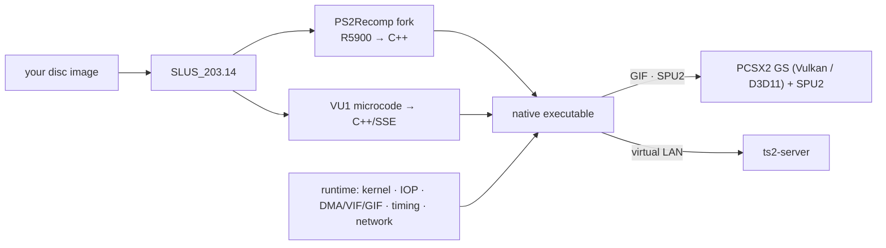

No CPU emulation at runtime: the game's MIPS code becomes C++ and is compiled for your PC. Only graphics (GS) and
sound (SPU2) come from PCSX2, through a small bridge library. The PS2 network adapter is emulated and connected to a
`ts2-server`, so the game's own LAN code plays online.

## Documentation

| | |
|---|---|
| [ONLINE](docs/ONLINE.md) | online multiplayer: how it works, roadmap · [host a server](server/README.md) |
| [MOUSE](docs/MOUSE.md) | mouse and keyboard play: how it is done, what is still open |
| [STEAM_DECK](docs/STEAM_DECK.md) | setup and Game Mode on the Deck |
| [WINDOWS_PORT](docs/WINDOWS_PORT.md) | how the Windows build works and how it was tested |
| [BUILDING](docs/BUILDING.md) | how the game is built on your PC, all settings |
| [CHANGELOG](docs/CHANGELOG.md) | every build and release |
| [FINDINGS](docs/FINDINGS.md) | every bug found against the reference and how it was fixed |
| [PERFORMANCE](docs/PERFORMANCE.md) | frame-rate measurements and optimisations |
| [VERIFICATION](docs/VERIFICATION.md) | how changes are checked |
| [KNOWN_ISSUES](docs/KNOWN_ISSUES.md) | open issues |

## Legal

- Tooling and runtime under GPL-3.0 (a fork of PS2Recomp), plus a patch and bridge for PCSX2 under PCSX2's license.
- **No code, data, textures, text, audio or BIOS from the game or from Sony.** Translations of the game's code are
  produced locally from your own disc and never committed.
- You must own the game and dump your own disc. Do not share dumps or generated code. This project provides no BIOS,
  keys or tools or instructions for getting around copy protection.
- Screenshots and clips in `docs/screenshots/` were taken from the port running the author's own disc.
- *TimeSplitters* is a trademark of its respective owners. This project is not affiliated with or endorsed by them.

## Credits

[PS2Recomp](https://github.com/ran-j/PS2Recomp) (recompiler and runtime base) · [PCSX2](https://pcsx2.net) (GS/SPU2
and the hardware reference) · [ps2autotests](https://github.com/unknownbrackets/ps2autotests) · ps2sdk and the PS2
homebrew community · methods from the author's
[Shadow of the Colossus port](https://github.com/Destinity13/shadow-of-the-colossus-recomp).

## AI disclosure

Built by a human maintainer together with Claude (Anthropic) working as a coding agent. The maintainer sets direction,
owns the hardware and play-testing and makes the decisions; the agent did most of the reverse engineering,
implementation, measurement and documentation. Every change is checked against the reference before it lands.
