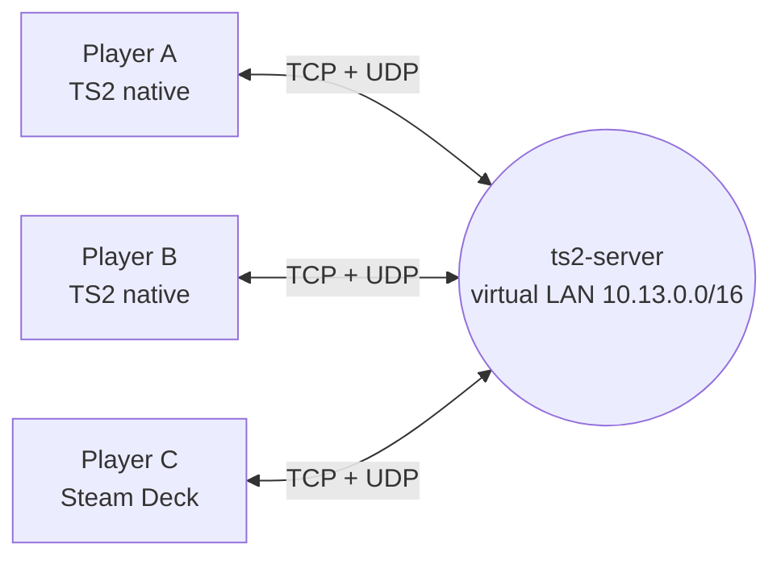

[← back to README](../README.md)

# Online multiplayer

> [!NOTE]
> **Status: in development.** The first online match ran on 8 November 2026: two copies of the game, connected
> through a `ts2-server`, found each other under *Join Game*, met in the lobby and played Deathmatch on Mexican
> Mission. The in-game server browser is built in; playtests over the internet are next. In the packages since 1.0.0.

TimeSplitters 2 on the PS2 had **LAN play** through the Network Adapter (up to 16 players). Online play was cut before
release. This port brings that LAN mode online. Nothing in the game changes: you use **Arcade → Network**, host with
*Start Game*, and join with *Join Game*. The difference is that your "LAN" is a server on the internet.

## How it works

The original chain on a PS2 is long: the boot code checks for the Network Adapter (`DEV9.IRX`), the network menu loads
Sony's INET stack on the I/O processor, reads a network configuration from the memory card, brings the link up, and the
game's own socket layer then talks to the stack through SIF RPC and shared ring buffers.

The port replaces that chain at three points and leaves the game's network code untouched above them:

| Original | In the port |
|---|---|
| `DEV9.IRX` reports the adapter, INET/SMAP/LIBNETB load on the IOP | adapter reported present, network modules counted as loaded |
| network configuration from the memory card (`ezNetCnf`), link up (`ezNetCtl`) | one configuration *"TS2 Online"*, link reported up |
| the game's socket backend on top of `libnet` (16 entry points) | a tunnel to `ts2-server` |

The game's socket layer uses four kinds of sockets, all carried by the tunnel:

| Game socket | Used for | Over the server |
|---|---|---|
| UDP | finding games (broadcast), the match itself | UDP, falls back to TCP |
| TCP connect / TCP wait | joining a hosted game | reliable stream relayed by the server |
| ICMP | the ping shown in the lobby | ping relayed by the server, real round-trip time |

Every player gets a virtual address in `10.13.0.0/16`. A broadcast to `10.13.255.255` (the game searching for hosts)
goes to everyone on the server. As on a real LAN, one player hosts the match; the server is the meeting point.

## Two bugs found on the way

- **The PS2 cycle counter stood still.** TS2 times its network send queue with the CPU's `Count` register (COP0 9,
  294.912 MHz). The recompiler translated `mfc0 Count` as a constant, so no time ever passed and queued packets were
  never sent. `mfc0 Count` now reads a running counter at the real rate; this fixes every other use of it as well.
- **Argument order of the socket backend.** `SendTo`/`RecvFrom` take the address before the buffer
  (`h, host, port, buf, len, done`); the first version had them the other way round.

## Roadmap

- [x] network adapter, configuration and link emulated; **Arcade → Network** available
- [x] `ts2-server`: players, virtual LAN, broadcasts, TCP streams, UDP with TCP fallback, ping, password, player limit
- [x] game-side tunnel, tested against the server (two simulated games find each other, connect, exchange data)
- [x] host and join a full match between two running copies of the game
- [x] **server browser** in the settings menu (tab *Online*, opens by itself at Arcade → Network): community server
      list ([server/servers.txt](../server/servers.txt)), favourites, player counts and ping, password prompt, direct address
- [ ] server browser tested on screen and with a gamepad (Steam Deck)
- [ ] playtests over the internet, latency tuning
- [x] `ts2-server` in the release packages (Linux `ts2-server`, Windows `ts2-server.exe`)
- [ ] later: headless host, so a server can run a match without a player hosting it

## Server browser

In the style of the classic PC shooters: the settings menu (ESC/F1, Guide button) has an **Online** tab, and it opens
by itself when the game reaches the network configuration (*Arcade → Network → Start Game / Join Game*). It lists the
servers from the community list [server/servers.txt](../server/servers.txt) and your favourites, asks each server for
its name, players and message, measures the ping, and connects with one click (or Enter / ✕ on a gamepad). Servers with
a password ask for it. Your player name and the chosen server are kept in the settings file.

Each `ts2-server` answers a small status query on its UDP port (`T2IN` + nonce → protocol, players, maximum, password
flag, name, message), so the browser needs no master server.

## Hosting a server

See [server/README.md](../server/README.md).
