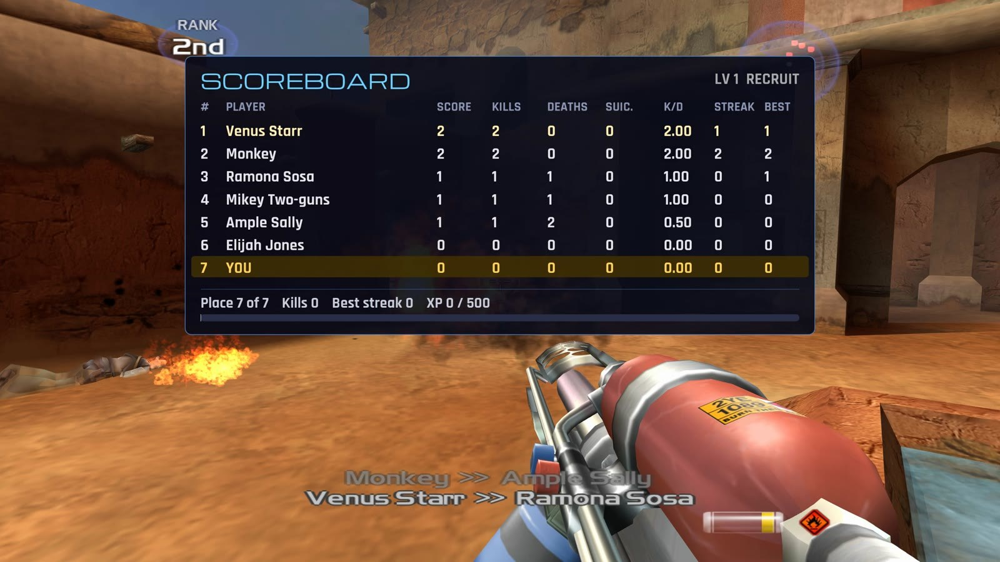
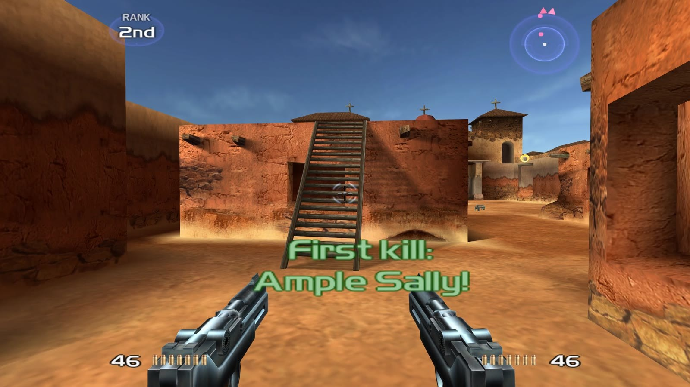
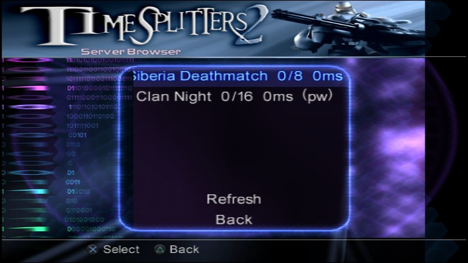
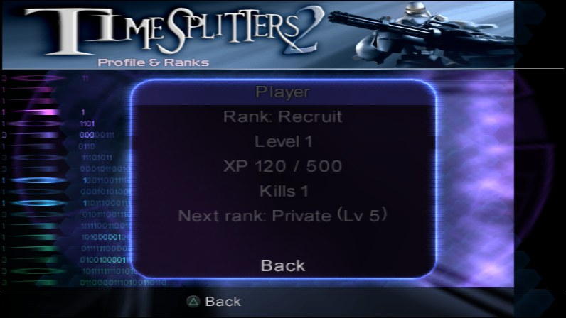
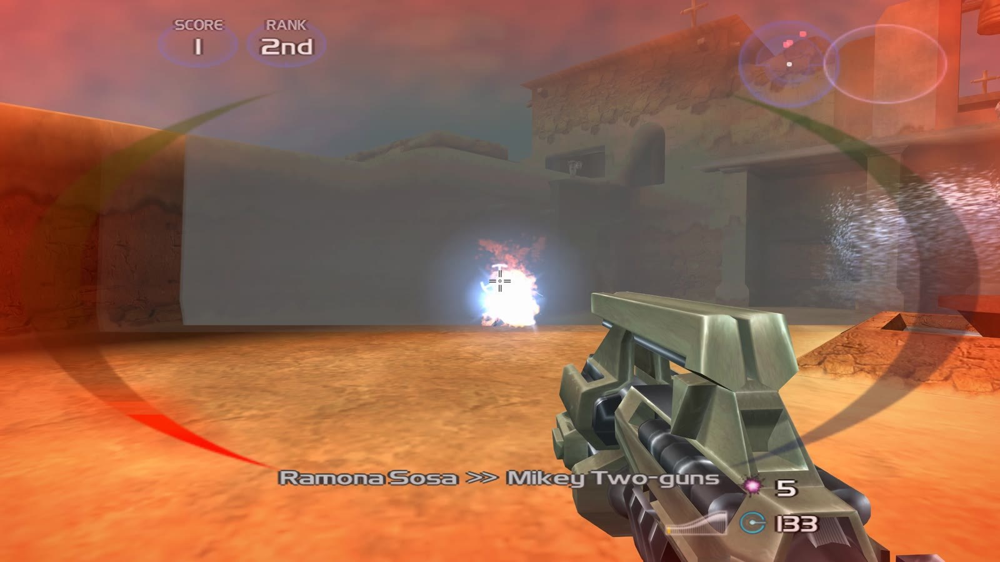

# Online+ - a first look

Online+ started with a simple question: what would TimeSplitters 2 multiplayer feel like if it had the things we wished for back then? More players, a reason to keep playing, and a bit more punch when you hit someone.

Before anything else: **Online+ is an extra.** The normal port stays exactly as it is, and you can play the classic multiplayer just like on the PS2. Online+ is a separate edition with its own save data. You pick in the launcher which one you want, or install both.

## Built from what the game already has

We didn't want an external window or an overlay app. Online+ shows up as a normal entry in the main menu, and everything after that happens inside the game.

Most of it reuses systems TimeSplitters 2 already has:

- The lobby, server browser and profile screens use the game's own menu engine: same frames, fonts, sounds and controls as every other menu.
- The killfeed and the multi-kill and streak messages use the on-screen message system the game uses for "First kill".
- Bot Match simply opens the game's Arcade setup.

Some things have no counterpart in the original, so the port draws them on top of the picture: the full scoreboard, the centre crosshair for mouse aiming and the hit markers.

## What's in it so far

- **Lobby** with Quick Match, Create Lobby, Server Browser, Bot Match and Profile & Ranks.
- **Server browser in the game:** server name, players, ping, and a mark for private servers. Quick Match picks a server for you.
- **XP, levels and ranks:** every hit and kill counts, from Recruit up to Legend. Ranks will be stored on the server so they follow you.
- **Killfeed and scoreboard:** who got whom, and the full table on Tab / Select with kills, deaths, streaks and your XP.
- **More impact:** recoil, a camera kick when you get hit, hit and kill markers with sound, and an announcer for multi-kills and streaks. Every effect can be switched off.
- **Bot Match** for when nobody's online.

## Where it stands

These are basic versions for now. We're mainly finding out what's possible inside the game and what isn't, so layout, wording and features will still change. It's being tested at the moment and will come with one of the next releases. The launcher installs updates by itself and backs up your saves first.
