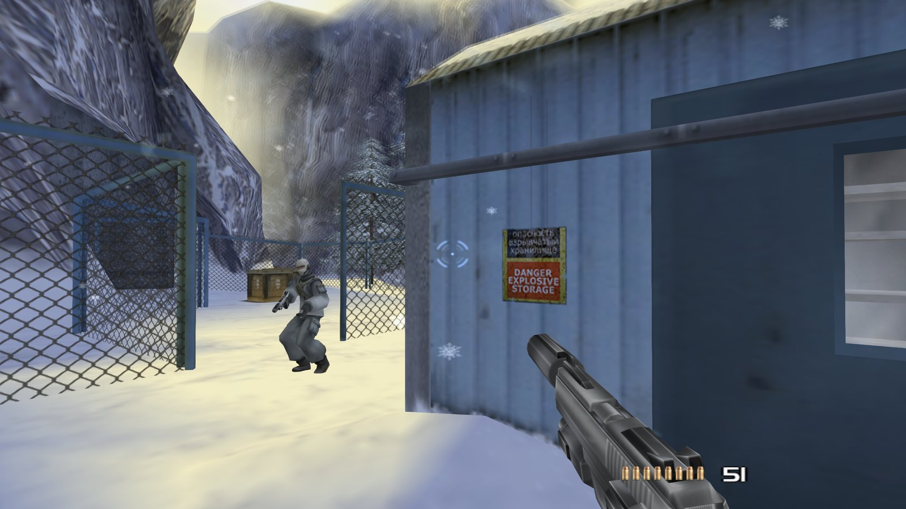
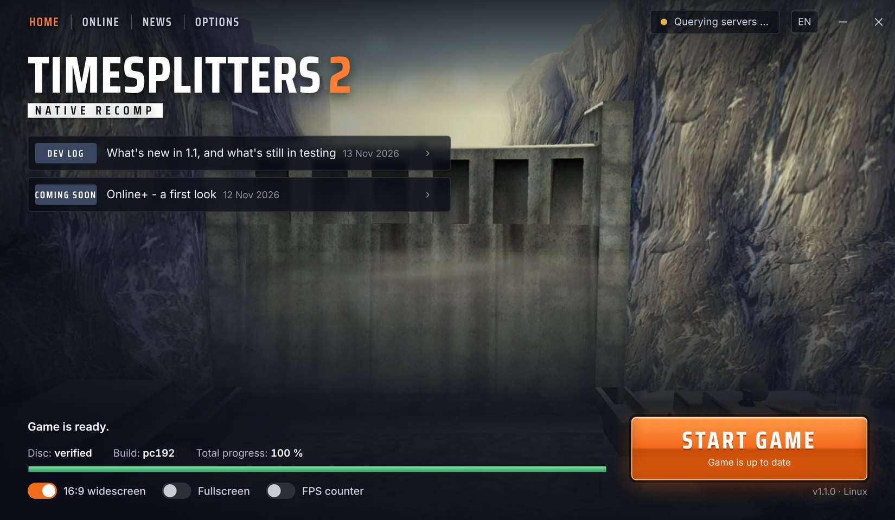
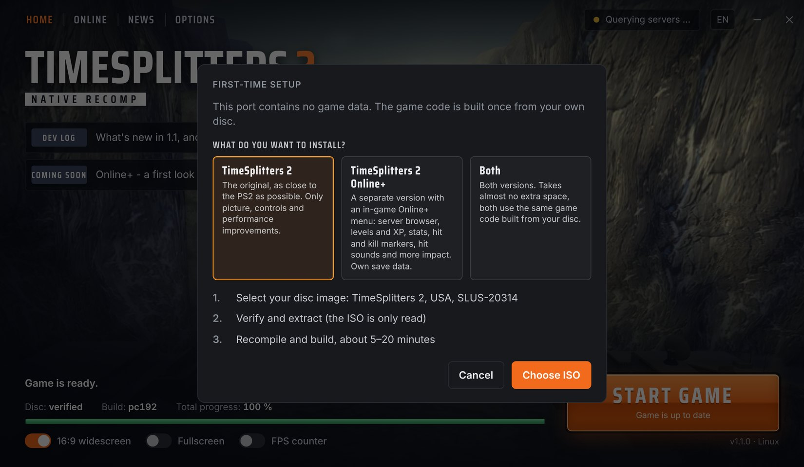
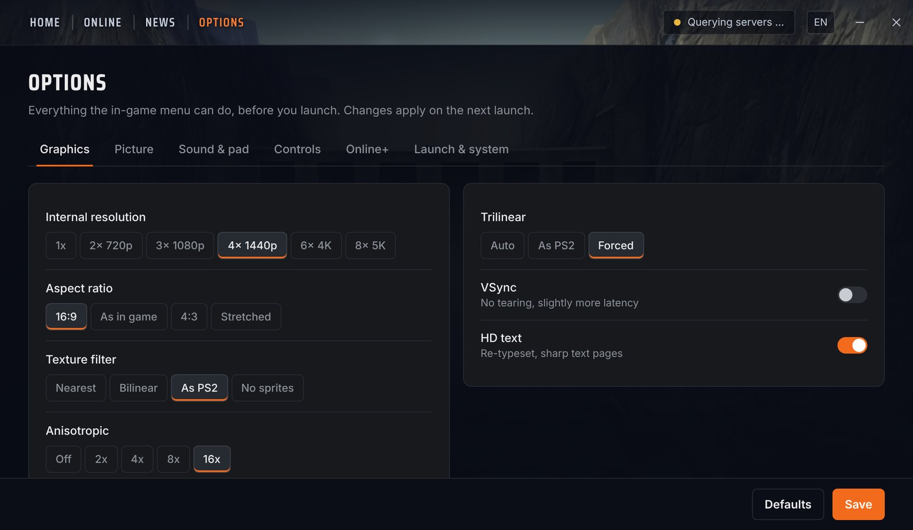
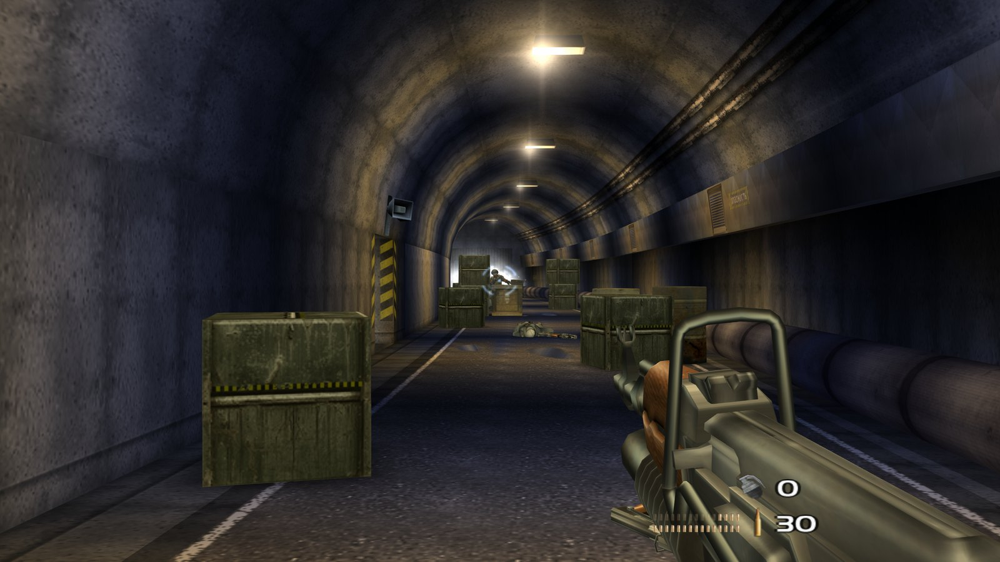
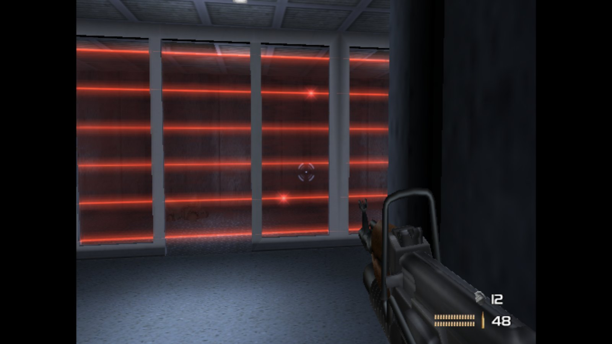

# What's new in 1.1, and what's still in testing

Quite a lot has changed since the last release. Here's an overview with an honest status for each part.

✅ done · 🧪 in testing · 🛠 being worked on · 🗓 planned

## The new launcher

The biggest visible change is the launcher. Before, setup ran through a script with simple dialogs. Now there's one small app that takes care of everything around the game.

**What's different about it:**

- **Small.** The launcher is about 7 MB on Linux and 5 MB on Windows. It uses the web view your system already has instead of shipping its own browser, so it starts fast and stays light. On Linux that means WebKitGTK has to be installed, which is already the case on most desktops.
- **No game data inside.** The package contains no game files at all. The launcher asks for your own disc image, checks it, and builds the game code from it once on your PC. Your ISO is only read, never changed.
- **One place for everything.** Picture, sound, controls, mouse and Online+ settings are all here before you start, the same options as the in-game menu.
- **Updates on their own.** Normal updates download only the files that changed. Your saves are backed up first, and update files may never touch save data. Bigger updates that need a new build ask first and reuse the disc image you set up before.
- **Two editions, one setup.** Original, Online+ or both. Both editions share the game code built from your disc, so the second one costs almost no extra space.
- **News and servers.** You see posts like this one and the online servers right on the start page.

| | |
|---|:-:|
| Setup from your own disc image, with progress display, no tools to install | ✅ |
| Choose the edition: Original, Online+ or both | ✅ |
| Settings for picture, controls, mouse and Online+ effects | ✅ |
| News tab | ✅ |
| Automatic updates: only changed files are downloaded, saves are backed up first | 🧪 |
| Bigger updates that need a new setup ask first and reuse your disc image | 🧪 |

## Picture

| | |
|---|:-:|
| 16:9 widescreen with a wider field of view | ✅ |
| HUD elements at the screen edges in 16:9 | ✅ |
| Menus laid out for 16:9 | ✅ |
| Up to 8x internal resolution | ✅ |
| Sniper scope option: Original, Clear or Extra clear (no smearing at high resolutions) | ✅ |
| No settings menu or extra text on screen when you start from the launcher | 🧪 |

## Controls

| | |
|---|:-:|
| Gamepad and keyboard | ✅ |
| Mouse aiming | ✅ |
| Shots land exactly on the crosshair | 🧪 |
| One clean crosshair, no camera pull from the game while you aim | 🛠 |
| Sniper zoom with the mouse | 🛠 |
| Full walking speed while aiming | 🗓 |

## Online

| | |
|---|:-:|
| Online multiplayer with community servers (since 1.0) | ✅ |
| Your own server, included in the package | ✅ |
| Online play over the internet with more players and more servers | 🧪 |

## Online+

An optional second edition. The classic game and its multiplayer stay as they are. More in the [Online+ post](2026-11-12-online-plus-coming.md).

| | |
|---|:-:|
| Online+ in the main menu, lobby in the game's own style | 🧪 |
| Server browser and Quick Match | 🧪 |
| XP, levels and ranks | 🧪 |
| Bot Match through the game's Arcade setup | 🧪 |
| Killfeed and announcer through the game's own messages | 🧪 |
| Scoreboard on Tab / Select | 🧪 |
| Hit and kill markers, hit sounds, recoil, camera kick | 🧪 |
| Ranks saved online | 🛠 |

## Platforms

| | |
|---|:-:|
| Linux | ✅ |
| Windows 10 / 11 (since 1.0.1) | ✅ |
| Steam Deck | ✅ |

The full list of changes for every build is in the [changelog](../docs/CHANGELOG.md), open problems are in [known issues](../docs/KNOWN_ISSUES.md).

*Status: November 2026. Things will still change.*
