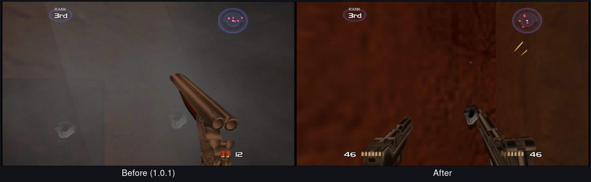

# Bug fixes and updates - 1.1 is on the way

Thanks to everyone who reported problems here and on Reddit. And sorry for the German! The launcher on Windows ignored the language you picked, and a few texts and file names were German too. That is fixed: everything is in English now, German is only a menu language you can choose.

This post lists everything that changed since 1.0.1. The update goes up as soon as the last round of testing is through, above all on Windows.

✅ done and tested · 🧪 done, final test on Windows still running

## Fixed from your reports

| | |
|---|:-:|
| **Launcher always in German on Windows**, no matter which language you picked ([#1](https://github.com/Destinity13/TimeSplitters-2-Native-Recomp-Windows-Linux-SteamDeck/issues/1), [#2](https://github.com/Destinity13/TimeSplitters-2-Native-Recomp-Windows-Linux-SteamDeck/issues/2)) | 🧪 |
| **Black bars at 16:9** on 16:10 screens. The picture now fits any screen: 16:9, 16:10, ultrawide ([#2](https://github.com/Destinity13/TimeSplitters-2-Native-Recomp-Windows-Linux-SteamDeck/issues/2)) | ✅ |
| **Big grey, flickering smoke wall** when bullets hit a surface ([#3](https://github.com/Destinity13/TimeSplitters-2-Native-Recomp-Windows-Linux-SteamDeck/issues/3)). Checked against the original running in PCSX2 | ✅ |
| **Slowdowns on weaker graphics cards**: the "Auto" resolution steps down by itself when the frame rate stays low ([#2](https://github.com/Destinity13/TimeSplitters-2-Native-Recomp-Windows-Linux-SteamDeck/issues/2)) | 🧪 |
| **Sniper scope did not open** with mouse aiming | ✅ |
| **Windows fullscreen:** the settings menu took clicks at the wrong place | 🧪 |
| Rare black screen or crash while taking screenshots or recording video | ✅ |
| Online+ lobby could freeze after a few seconds | ✅ |
| Game could open only an empty window on some Linux systems (a missing library is now bundled) | ✅ |

## Picture

- **Fits any screen:** 16:9, 16:10, 21:9 and 32:9 without bars or stretching, with more view to the sides
- **"Auto" internal resolution:** picks the best resolution for your screen and gives smooth edges with sharp textures
- **16:9 menus and HUD:** titles, button prompts, ammo and weapon icons sit at the edges of the wide picture instead of a 4:3 box in the middle
- **Sniper scope: Original, Clear or Extra clear.** The original zoom smear looks blurry at high resolutions, "Clear" keeps the look but stays sharp
- **Texture packs** in PCSX2 format: put the archive into the `texture_packs` folder and switch it on in the settings menu

## Controls

- **Mouse aiming rebuilt:** crosshair fixed in the centre, shots land on it, no auto-aim pulling the view, choice of crosshair style
- **Modern gamepad aiming (optional):** the right stick turns the view directly, with a turn speed setting. Off by default, the original controls stay as they are
- **Unlock everything (optional):** opens all levels and modes while it is switched on. Your own progress stays untouched

## New launcher

- One small app for setup, settings, news and updates, in English and German
- Setup from your own disc image with a progress display, nothing to install
- Updates download only the files that changed and back up your saves first

## Online+ (optional second edition)

- Its own lobby in the game's menus: server browser, quick match, bot match, profile and ranks
- Hit and kill markers, killfeed and scoreboard, all switchable
- The classic game and its multiplayer stay untouched

## Under the hood

- Crash reports now contain useful information
- Less CPU load from the hidden helper window, smaller log files
- A test suite that replays story, sniper, deathmatch and Online+ scenes before every package
- Everything in English: launcher, settings file, folders and log messages

## What's next

- An auto-aim switch for the original controls
- The new options inside the game's own menus
- More comparisons against the original, scene by scene

Everything new is optional. The game as it was on the PS2 stays the default.

Found something that still looks wrong? [Open an issue](https://github.com/Destinity13/TimeSplitters-2-Native-Recomp-Windows-Linux-SteamDeck/issues) and tell us your system, graphics card and the internal resolution you use.
